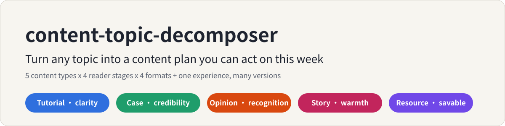
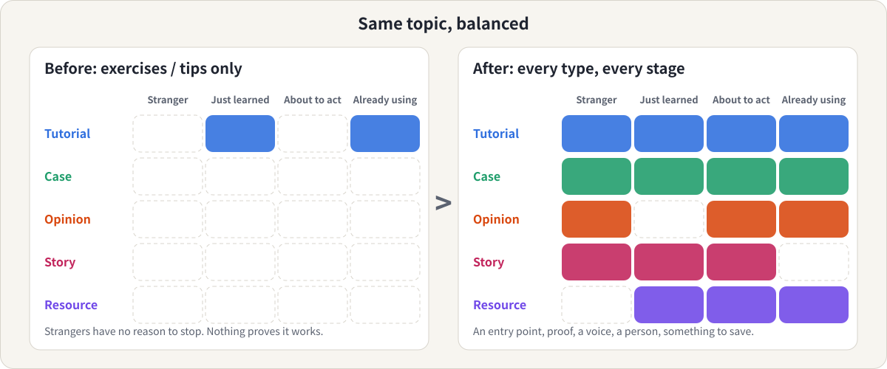
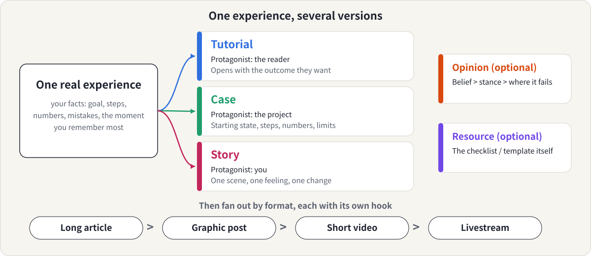

<p align="center">
  
</p>

<p align="center">
  <b>English</b> &nbsp;|&nbsp; <a href="README.zh-CN.md">简体中文</a>
  &nbsp;|&nbsp; <a href="LICENSE">MIT License</a>
</p>

A [Claude](https://claude.ai) skill for people who **know a topic well but keep making the same kind of post.**

You tell Claude your topic. It gives you back a plan: what to make, for whom, in what form, and which of your own experiences to build it from.

## Is this for you?

- You know your field well, but every post is a tip list, a how-to or an exercise demo, and you are running out of angles.
- Your audience isn't growing, and you suspect the content has no way in for strangers and no proof for people deciding whether to trust you.
- You have real experience (projects, experiments, clients, mistakes) but haven't turned it into content.
- You post on Xiaohongshu, WeChat, Instagram, a blog or a newsletter, and you want one plan instead of five separate guesses.

It works for any topic that has an audience: technical, craft, health, lifestyle, creative, or a business. It is not limited to business topics.

## What you get

For your topic, Claude produces:

1. **A map of about 20 ideas** across five content types, each with a working title, an angle, a reader stage, a format and the real material you need to supply.
2. **A coverage check** that shows which reader stage or content type you are missing, and what to make first.
3. **Two or three "hero" experiences**, each turned into tutorial, case and story versions with different protagonists and hooks (the 一鱼多吃 idea).
4. **A suggested order** to publish in. A dated calendar only if you ask.

It plans. It doesn't write the final posts unless you ask for that next.

## The idea in 30 seconds

Each content type does a different job for the reader. A mature topic needs all five.

| Type | Gives the reader | The question it answers |
|---|---|---|
| Tutorial | clarity | How do I do or understand this? |
| Case | credibility | Has anyone done this, and what changed? |
| Opinion | recognizability | What do you believe that others don't? |
| Story | warmth, a reason to remember you | Who is the person behind this? |
| Resource | something to save and share | What can I keep and reuse? |

Then every idea is placed on two more axes: **reader stage** (stranger, just learned, about to act, already using) and **format** (graphic post, short video, long article, livestream).

<p align="center">
  
</p>

The grid on the right has the shape of the plan produced for the physiotherapist example below.

## One experience, several versions

Reusing material is not the same as copying it at different lengths. The skill rewrites one experience with a different protagonist, opening and ending for each version, then fans it out across formats.

<p align="center">
  
</p>

## See it work

Two real outputs are included, unedited apart from a short note at the top:

| Request | Output |
|---|---|
| "I'm a physiotherapist. I only post exercises and I'm not growing. I've treated about 200 desk workers over 6 years." | [examples/back-pain-physio.en.md](examples/back-pain-physio.en.md) (English) |
| 「我想围绕大模型后训练里的 SFT 做一系列内容，想发公众号和博客」 | [examples/sft-post-training.zh.md](examples/sft-post-training.zh.md) (中文) |

A taste of the physiotherapist plan's diagnosis:

> Your current content (exercise tutorials) sits almost entirely in column D, for people who already have the problem and are already following you. That's a small pool, and it explains the plateau. The gaps that matter are stage A (nothing makes a stranger stop) and stage C (no proof you get results).

Notice what the plan does **not** contain: invented patients, results or numbers. See the next section.

## It won't make up your experience

Cases and stories only work if they are true. So wherever a case or story needs real material, the plan leaves a **slot** and tells you what kind of experience to dig up ("a patient whose plan didn't work the first time"), without suggesting a cause, ending or number you might copy into your post as if it had happened to you. If you have little experience yet, it suggests cheap ways to create some: a small experiment, a reproduced public result, a clearly labelled teardown of someone else's work.

Opinions are written as candidate stances (common belief, then your stance, then where it would be wrong), and you keep only the ones you actually hold.

## Install

**Claude Code** (personal skill):

```bash
git clone https://github.com/meiluosi/content-topic-decomposer.git
cp -r content-topic-decomposer/skills/content-topic-decomposer ~/.claude/skills/
```

**Claude.ai / Claude desktop:** zip the `skills/content-topic-decomposer` folder (so that `SKILL.md` sits inside it) and upload it under Settings → Capabilities → Skills.

## Use

Just describe your topic and what you publish. For example:

- "I know a lot about X. Help me turn it into a content series."
- "All my posts are tips. What else should I be posting?"
- "Break down 'LLM evaluation' into a content plan for my blog and LinkedIn."
- "I had a rough project last month. Turn it into a tutorial, a case and a story."
- 「把『新手理财』拆成一套小红书选题」

The more real material you mention (projects, experiments, clients, mistakes), the more specific the case and story slots become. You can name a platform (Xiaohongshu, WeChat official account, Instagram, Substack, a blog) and it will adapt; if you don't, it stays at the format level.

## Pairs with

If your topic comes from something you are still learning or testing, [research-learning](https://github.com/meiluosi/research-learning) comes first: it teaches an ML/LLM technique, and its real experiment results are the material this skill's case and story slots ask for. Once you have the plan, [human-in-the-loop-writing](https://github.com/meiluosi/human-in-the-loop-writing) takes one item from it and turns it into a piece you stand behind: research the topic, draft from your own claim and experience, audit it, and learn your editing rules. Then [content-card-designer](https://github.com/meiluosi/content-card-designer) can turn the finished piece into image cards, covers or an avatar: text laid out by a browser, your real assets untouched, and a quality check before export.

## How well does it work?

Honest answer: only small tests so far. The first version was compared with plain Claude (no skill) on three prompts: a Chinese technical topic, an English health topic, and a reuse-one-experience request. On a checklist written by the author (all five types covered, stage and format tags, coverage check, reuse chains, no invented experience, correct language), the skill passed 21 of 21 checks and plain Claude passed 11 of 21. Plain Claude's answers were useful, but organised by sub-topic, with no stage tags, coverage check or reuse chain.

Treat this as a sanity check, not a benchmark: the checklist was written and scored by the author, there were three prompts, and the runs are not published. The skill was revised after those tests, and the two examples in this repo come from re-runs of the revised version. Issues and examples from your own topics are very welcome.

## What's inside

```
skills/content-topic-decomposer/
├── SKILL.md                    # workflow and principles
└── references/
    ├── five-types.md           # jobs, generating questions, quality bars, failure modes
    ├── reader-stages.md        # the four reader stages
    ├── formats.md              # four formats and which type fits which
    ├── repurposing.md          # one experience -> several versions
    └── output-template.md      # shape of the final plan
examples/                       # two worked examples
assets/                         # diagrams used in this README
```

## Credit

The five-type split is adapted from the framework described in the book 《把自己变成一门生意》. This repository is an independent implementation and contains no text from the book.

## License

[MIT](LICENSE)
