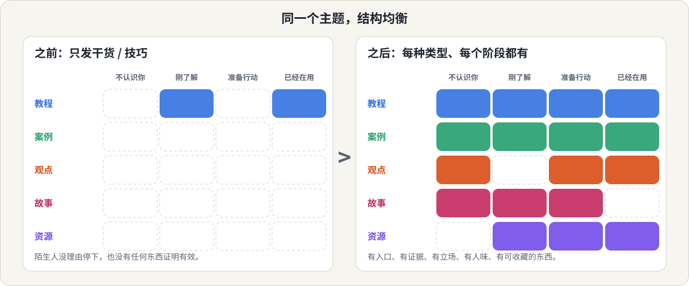
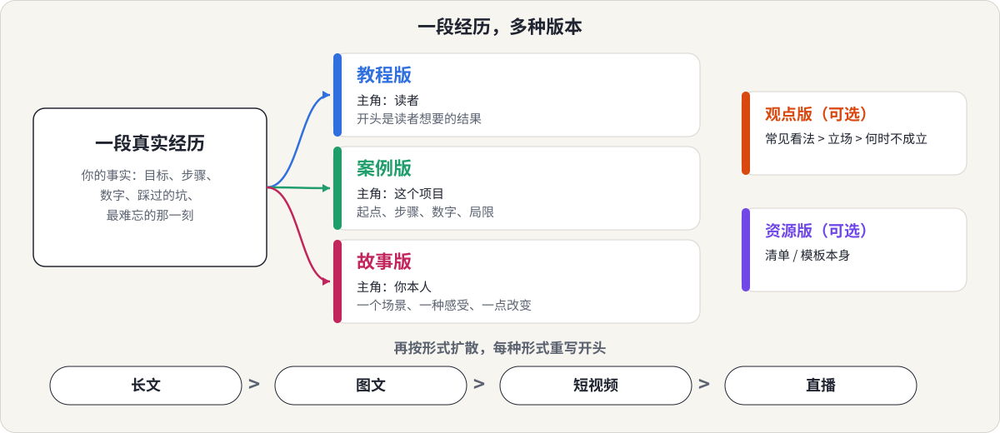

<p align="center">
  
</p>

<p align="center">
  <a href="README.md">English</a> &nbsp;|&nbsp; <b>简体中文</b>
  &nbsp;|&nbsp; <a href="LICENSE">MIT 许可</a>
</p>

一个 [Claude](https://claude.ai) skill，写给**很懂某个主题、却总在重复发同一种内容**的人。

你告诉 Claude 你的主题，它还你一份规划：做什么、写给谁、用什么形式，以及该从你自己的哪段经历里取材。

## 这是写给你的吗？

- 你对自己的领域很熟，但每篇都是干货清单、教程或动作演示，越来越没有新角度。
- 账号涨不动，你怀疑是内容没有让陌生人停下来的入口，也没有让犹豫的人信任你的证据。
- 你有真实经历（项目、实验、客户、踩过的坑），却一直没把它变成内容。
- 你在小红书、公众号、Instagram、博客或邮件通讯上发内容，想要一套整体规划，而不是五份各自摸索的猜测。

任何有读者的主题都适用：技术、手艺、健康、生活方式、创作，也包括商业。不限于商业主题。

## 你会得到什么

针对你的主题，Claude 会产出：

1. **约 20 个选题的地图**，分布在五种内容类型里，每个选题都有暂定标题、角度、读者阶段、形式，以及需要你提供的真实素材。
2. **覆盖检查**：指出你缺了哪个读者阶段或哪种类型，先做什么。
3. **2～3 段核心经历**，每段改写成教程版、案例版、故事版，主角和钩子各不相同（一鱼多吃）。
4. **建议的发布顺序**。只有你要求时才给带日期的日历。

它做规划，不会直接代写成稿；你可以接着让它写。

## 30 秒讲清思路

每种内容类型为读者完成不同的任务，一个成熟的主题需要五种都有。

| 类型 | 给读者什么 | 回答什么问题 |
|---|---|---|
| 教程 | 清晰度 | 我怎么做、怎么看懂？ |
| 案例 | 可信度 | 真有人做过吗？有什么变化？ |
| 观点 | 辨识度 | 你相信什么，和别人有什么不同？ |
| 故事 | 温度，让人记住你 | 这背后是个什么样的人？ |
| 资源 | 可收藏、可转发 | 我有什么可以留着反复用？ |

然后每个选题再放到另外两条轴上：**读者阶段**（不认识你、刚了解、准备行动、已经在用）和**形式**（图文、短视频、长文、直播）。

<p align="center">
  
</p>

右边这张网格的形状，对应下面理疗师示例里生成的规划。

## 一段经历，多种版本

复用不是把同一段文字换个长度。这个 skill 会为每个版本换一个主角、开头和结尾，再按形式扩散。

<p align="center">
  
</p>

## 看它怎么工作

仓库里有两份真实输出，除开头的一小段说明外没有改动：

| 请求 | 输出 |
|---|---|
| 「我想围绕大模型后训练里的 SFT 做一系列内容，想发公众号和博客」 | [examples/sft-post-training.zh.md](examples/sft-post-training.zh.md)（中文） |
| "I'm a physiotherapist. I only post exercises and I'm not growing."（英文） | [examples/back-pain-physio.en.md](examples/back-pain-physio.en.md)（English） |

理疗师那份规划里的诊断节选（原文为英文，大意）：

> 你现在的内容（动作教程）几乎全部落在 D 列，面向的是已经有这个问题、也已经关注你的人。这个池子很小，也解释了为什么涨不动。真正的缺口在 A 阶段（没有东西能让陌生人停下）和 C 阶段（没有你能带来结果的证据）。

注意这份规划里**没有**的东西：编造的病人、结果或数字。见下一节。

## 它不会替你编经历

案例和故事只有真实才有用。所以凡是需要真实素材的地方，规划只留一个**空位**，告诉你该去找哪一类经历（比如"一次方案第一次没奏效的案例"），不会暗示某个原因、结局或数字，免得你把它当成自己的经历写进文章。如果你经验还不多，它会给便宜的补素材办法：做一个小实验、复现一个公开结果、拆解别人公开的作品并明确标注。

观点以"候选立场"的形式给出（常见看法、你的立场、何时不成立），你只保留自己真正认同的。

## 安装

**Claude Code**（个人 skill）：

```bash
git clone https://github.com/meiluosi/content-topic-decomposer.git
cp -r content-topic-decomposer/skills/content-topic-decomposer ~/.claude/skills/
```

**Claude.ai / Claude 桌面端**：把 `skills/content-topic-decomposer` 文件夹打成 zip（`SKILL.md` 在文件夹里面），在 设置 → 能力 → Skills 中上传。

## 使用

直接描述你的主题，以及你在哪里发内容。例如：

- "我很懂某个主题，帮我做成一套系列内容。"
- "我的内容全是干货技巧，还应该发什么？"
- "把『LLM 评测』拆成适合博客和 LinkedIn 的内容规划。"
- "我上个月做了个很折腾的项目，帮我做成教程、案例和故事三个版本。"
- "把『新手理财』拆成一套小红书选题。"

你提供的真实素材（项目、实验、客户、踩过的坑）越多，案例和故事的空位就越具体。你可以说出平台（小红书、公众号、Instagram、Substack、博客），它会按平台调整；不说的话，就只停留在形式层面。

## 效果如何？

诚实地说：目前只做过小规模测试。我把第一版 skill 和不带 skill 的 Claude 放在三个问题上对比：一个中文技术主题、一个英文健康主题、一个"复用一段经历"的请求。用作者自己写的检查清单打分（五种类型都覆盖、阶段和形式标注、覆盖检查、复用链、不编造经历、语言正确），带 skill 的版本通过 21 项中的 21 项，不带 skill 的通过 21 项中的 11 项。不带 skill 的回答也有用，但按子主题组织，没有阶段标注、覆盖检查和复用链。

请把它当作一次自查，而不是正式基准：检查清单由作者编写并打分，只有三个问题，运行记录没有公开。测试之后 skill 又做过修改，仓库里的两份示例来自修改后版本的重新运行。欢迎提 issue，也欢迎贡献你自己主题的示例。

## 目录

```
skills/content-topic-decomposer/
├── SKILL.md                    # 工作流与原则
└── references/
    ├── five-types.md           # 任务、提问、质量标准、常见失败
    ├── reader-stages.md        # 四个读者阶段
    ├── formats.md              # 四种形式及其与类型的搭配
    ├── repurposing.md          # 一段经历 -> 多个版本
    └── output-template.md      # 最终规划的输出结构
examples/                       # 两份真实示例
assets/                         # README 里用到的示意图
```

## 致谢

五种内容类型的划分改编自《把自己变成一门生意》一书中的框架。本仓库为独立实现，不包含该书原文。

## 许可

[MIT](LICENSE)
